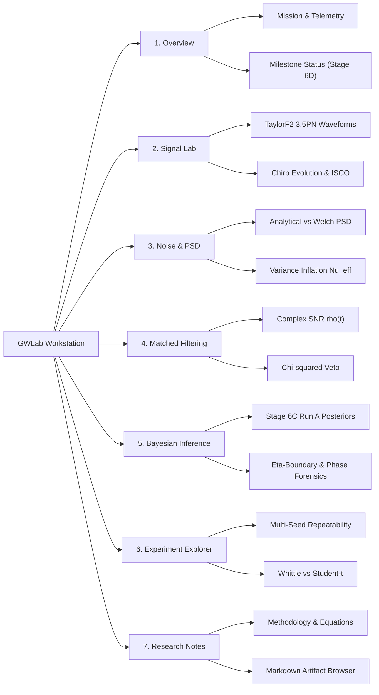
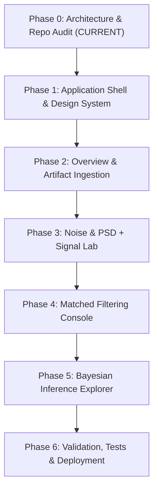

# GWLab — Phase 0: Repository Audit and Application Architecture Specification

**Document Version:** 1.0.0-PROD  
**Date:** 2026-11-19  
**Role:** Senior Software Architect & Scientific Visualization Engineer  
**Project:** Gravitational-Wave Matched-Filtering & Bayesian Inference (`gw-inference` / `gwlab`)  
**Target Environment:** Python 3.13.5 (`win_amd64`), Streamlit 1.67.0, Plotly 7.1.0  
**Status:** ARCHITECTURAL SPECIFICATION & READ-ONLY AUDIT (PHASE 0 GATE)  
**Deliverable Path:** `reports/GWLab_Phase0_Architecture_and_Repository_Audit.md`

---

## 1. Executive Summary & Recommendation

### 1.1 Executive Recommendation
We recommend proceeding with the phased development of **GWLab**—a research-grade, interactive gravitational-wave analysis laboratory—utilizing **Streamlit 1.67.0** paired with **Plotly 7.1.0**, structured under an isolated, modular application package (`src/gwlab/`). 

GWLab is engineered primarily as a scientific workstation to explore, audit, and understand the real experimental outputs produced by the `gw-inference` engine, while adhering to the highest standards of scientific reproducibility, data provenance, and visual elegance.

The empirical feasibility spike completed in `experiments/gwlab_streamlit_spike/` confirmed that Streamlit 1.67.0 satisfies the interactive performance requirements (median rerun latency $p_{50} = 60.8\,\text{ms}$, 95th percentile $p_{95} = 98.2\,\text{ms}$ on desktop hardware) and successfully achieves an **IBM Carbon / JupyterLab / GWOSC** instrument aesthetic with custom styling. However, to guarantee scientific integrity and software reliability, development must strictly observe four binding architectural constraints:
1. **Decoupled Read-Only Execution:** GWLab initial releases (Phases 1–5) must remain **strictly read-only** with respect to parameter estimation. The UI thread shall **never** directly invoke Dynesty nested sampling, evaluate expensive frequency-domain likelihood loops, or mutate saved scientific artifacts. All Bayesian posterior displays, diagnostics, and comparison workbenches must ingest pre-computed, schema-validated artifacts.
2. **Package Isolation (`src/gwlab/`):** The application must reside in a dedicated package (`src/gwlab/`), referencing the core scientific engine (`src/gw_inference/`) strictly as an upstream dependency for data structures, constants, deterministic waveforms, and filter math. Core algorithms must not be duplicated, forked, or silently modified within the UI layer.
3. **Desktop/Tablet Primary Target:** Responsive layout support is bounded to desktop ($W \ge 1440\,\text{px}$) and tablet ($W \ge 1024\,\text{px}$) viewports. Viewports at $\le 390\,\text{px}$ (mobile) exhibit minor horizontal container overflow ($19\,\text{px}$) and are designated solely for auxiliary status monitoring.
4. **Strict Pinning of UI Dependencies:** Key workstation styling relies on targeted CSS injection over Streamlit container elements. Streamlit minor versions must remain pinned to avoid breaking layout changes.

---

## 2. Part A — Formal Scientific Milestone Closeout (Stage 6D Pathway A)

### 2.1 Final Milestone Decision Record
In accordance with the project owner's mandate and the scientific evaluation documented in `reports/WP6_Stage6D_Sampler_Repeatability_Design_and_Resource_Review.md`, the formal decision for **Stage 6D (Sampler Repeatability & Resource Feasibility)** is recorded as follows:

| Governance Item | Authorized Project State |
| :--- | :--- |
| **Milestone Closeout** | **Stage 6D is formally closed via Pathway A (Historical Baseline Comparison).** |
| **Scientific Finding** | These are two independent-PRNG-seed runs of the same frozen inference configuration and data realization (`run_a_anchor` [Seed 8101] and `base_01_plug_inst_s2` [Seed 8201]). The observed evidence difference is approximately $2.9720\,\text{nats}$, while the quadrature-combined reported internal evidence uncertainty is approximately $0.3332\,\text{nats}$, yielding a ratio of approximately $8.92$. This constitutes an observed discrepancy relative to the runs' reported internal uncertainties. This ratio is not a calibrated frequentist significance, does not estimate a population-level seed variance, and does not establish general sampler failure. |
| **Computational Ledger** | Remaining project budget is **fully preserved**: **712,593 likelihood calls**, **$1,326.84\,\text{s}$ CPU time**, and **$2,485.05\,\text{s}$ wall time** remain in the confirmed ledger (`experiments/wp6_stage6c_anchor/stage6c_aggregate_ledger.json`). |
| **Proposed Runs** | **Seed 8301 remains a future research proposal only.** Run B and the reduced pilot remain **strictly unauthorized**. |
| **Execution Authorization** | **Zero new sampler executions, likelihood loops, or simulations are authorized.** |
| **Scientific Caveat** | Deterministic numerical reproducibility of historical artifacts is verified, but **sampler reliability, asymptotic convergence, calibrated coverage, posterior topology, and general repeatability have NOT been established**. |

### 2.2 Numerical Audit of the Anchor Historical Pair

```
================================================================================
Stage 6D Frozen Realization 01 Independent-Seed Repeatability Summary
--------------------------------------------------------------------------------
Parameter / Metric         Seed 8101 (Run A Anchor)      Seed 8201 (Stage 5G.2 Base)    Discrepancy / Tension
--------------------------------------------------------------------------------
Evidence ln(Z)             201,646.1413 +/- 0.2374       201,643.1693 +/- 0.2338        |Delta ln Z| = 2.9720 nats (z = 8.92)
Likelihood Evaluations     487,407 calls                 485,349 calls                  Delta = +2,058 calls (+0.42%)
CPU Execution Time         473.16 s                      468.21 s                       Delta = +4.95 s (+1.06%)
Wall-Clock Time            514.95 s                      509.80 s                       Delta = +5.15 s (+1.01%)
Chirp Mass Mc (median)     28.1965 M_sun                 28.0945 M_sun                  Delta Mc = +0.1020 M_sun (+2.21 sigma)
Symmetric Mass Ratio eta   0.2481                        0.2381                         Delta eta = +0.0100 (+3.64 sigma)
Coalescence Time tc        1.99941 s                     1.99981 s                      Delta tc = -0.00040 s (-1.48 sigma)
Coalescence Phase phic     0.0538 rad (3.08 deg)         1.8120 rad (103.82 deg)        |Delta phi| = 1.7582 rad (100.74 deg)
Boundary Mass (top 1% eta) 38.57%                        0.35%                          Ratio = 110.2x
Boundary Mass (top 5% eta) 96.70%                        18.35%                         Ratio = 5.27x
Circular Resultant R1      0.6991 (p < 1e-15)            0.4120 (p < 1e-15)             Delta R1 = +0.2871
================================================================================
```

*Scientific Interpretation:* The historical baseline comparison demonstrates that for the specified likelihood and prior under this frozen inference problem, the two independent random seeds explore the parameter space differently, resulting in an observed evidence discrepancy of approximately $2.9720\,\text{nats}$ relative to their reported internal uncertainties ($z_{\rm rep} \approx 8.92$). As emphasized in the milestone decision, this ratio is an observed discrepancy relative to internal uncertainties, not a calibrated frequentist significance, and does not establish general sampler failure or convergence. Because Stage 6D closes on these historical facts without consuming the remaining 712,593-call reserve, all remaining computational resources are safely banked for future research gates.

---

## 3. Part B — Read-Only Repository & Package Audit

### 3.1 Repository Structure and Modular Taxonomy
A comprehensive audit of the workspace (`c:\Users\Soumitra\Desktop\GW-matched-filtering-and-baysian-interference`) establishes the following authoritative organization:

```
GW-matched-filtering-and-baysian-interference/
├── pyproject.toml                     # Root package configuration (setuptools)
├── README.md                          # Repository overview and setup instructions
├── src/
│   └── gw_inference/                  # Core scientific computation library
│       ├── __init__.py                # Authoritative public exports
│       ├── constants.py               # SI constants (G, c, M_sun, Mpc, gamma_E, C_isco)
│       ├── conventions.py             # Fourier transforms, scaling, discrete Parseval
│       ├── grid.py                    # FrequencyGrid domain and band masking
│       ├── noise.py                   # Stationary Gaussian noise (white and colored)
│       ├── psd.py                     # Welch PSD, Tukey windowing, variance inflation
│       ├── waveform.py                # TaylorF2 3.5PN frequency-domain approximants
│       ├── filter.py                  # Matched filtering, SNR series, chi^2 veto
│       ├── likelihood.py              # Whittle and Student-t frequency-domain likelihood
│       ├── prior.py                   # 2D & 4D prior transforms, Total Mass-Eta Jacobians
│       ├── posterior.py               # Parameter wrappers (2D and 4D likelihood bindings)
│       ├── sampler.py                 # NestedSamplerAdapter (Dynesty interface)
│       ├── semi_analytic.py           # Bessel I_0 phase/time marginalization
│       ├── diagnostics.py             # Posterior statistics, ESS, circular moments, KS
│       └── resource_control.py        # LikelihoodBudgetGuard, ExecutionWatchdog, Ledger
├── tests/                             # Pytest test suite (20 test modules)
│   ├── test_wp0_conventions.py        # Discrete Fourier transform & scaling tests
│   ├── test_wp0_parseval.py           # Parseval energy conservation validation
│   ├── test_wp1_grid_and_psd.py       # FrequencyGrid & analytical PSD validation
│   ├── test_wp2_waveform.py           # TaylorF2 phase, amplitude, and ISCO tests
│   ├── test_wp3_filter.py             # Matched filter, SNR time series, chi^2 veto tests
│   ├── test_wp4_likelihood.py         # FrequencyDomainGaussianLikelihood unit tests
│   ├── test_wp5_noise_psd.py          # Synthetic noise generation and Welch tests
│   ├── test_wp5_welch.py              # Deep Welch PSD covariance and leakage tests
│   ├── test_wp6_sampler_foundation.py # Dynesty adapter unit tests
│   ├── test_wp6_stage3_inference.py   # 4D parameter estimation verification
│   ├── test_wp6_stage4_diagnostics.py # Linear and circular posterior moment tests
│   ├── test_wp6_stage4_harness.py     # Injection-recovery campaign harness tests
│   ├── test_wp6_stage5_stage_f.py     # CBC likelihood validation tests
│   ├── test_wp6_stage5_stage_g1.py    # Multi-seed pilot consistency tests
│   ├── test_wp6_stage6b_prior_transform.py # Jacobian and coordinate transform tests
│   ├── test_wp6_stage6c_production_runner_mocked.py # Subprocess runner mock tests
│   └── test_wp6_stage6c_resource_control.py # BudgetGuard and Watchdog unit tests
├── scripts/                           # Standalone execution and analysis scripts (20 scripts)
│   ├── run_wp6_stage6c_anchor.py      # Production runner for Stage 6C Anchor execution
│   ├── run_wp6_stage5_stage_g2.py     # Production runner for Stage 5G.2 campaign
│   ├── run_wp6_stage5_stage_g1.py     # Production runner for Stage 5G.1 pilot
│   ├── run_wp6_stage4_campaign.py     # Tier 1 and Tier 2 injection-recovery harness
│   ├── analyze_cost_model_stage_g4a.py# Computational scaling and budget modeling
│   ├── analyze_wp6_stage5_stage_g3.py # Forensic analysis of Stage 5G posterior samples
│   ├── compute_corr_se.py             # Circular moment standard error calculator
│   └── postprocess_wp6_stage5_stage_g2.py # Extraction and aggregation of Stage 5G.2
├── experiments/                       # Experimental execution outputs and prototypes
│   ├── wp6_stage6c_anchor/            # Stage 6C production anchor execution outputs
│   └── gwlab_streamlit_spike/         # Completed UI feasibility spike prototype
└── reports/                           # Comprehensive research and milestone reports
    ├── WP6_Stage6D_Sampler_Repeatability_Design_and_Resource_Review.md
    ├── WP6_Stage6C_Run_A_Anchor_Execution_Report.md
    ├── WP6_Stage6C_Run_A_Posterior_Forensic_Analysis.md
    ├── WP6_Stage6C_Run_A_Forensic_Clarification.md
    ├── WP6_Stage6C_Closeout_and_Next_Research_Decision.md
    └── demonstrations/                # Curated experimental data and figures
        ├── figures/                   # Foundational WP1-WP3 demonstration PNGs
        ├── wp6_stage2/                # Stage 2 (2D) grid and sampler NPZ/JSON
        ├── wp6_stage3/                # Stage 3 (4D) grid and sampler NPZ/JSON
        ├── wp6_stage4/                # Tier 1 & Tier 2 injection recovery campaigns
        └── wp6_stage5/                # Stages 5B, 5C, 5D, 5E1, 5E2, 5F, 5G1, 5G2 data
```

### 3.2 Python Runtime and Environment Audit
- **Active System Python:** `Python 3.13.5 (tags/v3.13.5:6cb20a2, Jun 11 2025, 16:15:46) [MSC v.1943 64 bit (AMD64)]`
- **Host OS:** Windows 11 Enterprise (Build 26100)
- **Root Environment Installed Packages:**
  * `numpy`: 2.1.2 (Core array operations)
  * `scipy`: 1.16.0 (Signal processing, special functions, optimization)
  * `matplotlib`: 3.10.3 (Static publication plotting)
  * `pandas`: 2.2.3 (Tabular data analysis)
  * `dynesty`: 3.1.0 (Nested sampling engine)
  * `pytest`: 9.2.0 (Testing framework)
  * `rich`: 14.1.0 (Terminal formatting)
  * `fastapi`: 0.165.0 (ASGI framework, installed for API services)
- **Feasibility Spike Environment (`experiments/gwlab_streamlit_spike/.venv`):**
  * `streamlit`: 1.67.0 (Web application framework)
  * `plotly`: 7.1.0 (Interactive charting)
  * `altair`: 6.3.0 (Declarative visualization)
- **Packaging Configuration (`pyproject.toml`):**
  * Declares `gw-inference` version `0.1.0`.
  * Core dependencies: `numpy>=1.24.0`.
  * Optional dependency groups: `test = ["pytest>=7.0.0"]`, `sampling = ["dynesty>=2.1.0"]`.
  * *Critical Observation:* `streamlit` and `plotly` are not yet declared in `pyproject.toml`.

### 3.3 Execution Architecture and Resource Controls
The repository features an enterprise-grade execution architecture designed to prevent unconstrained execution:
1. **Subprocess Isolation:** Production sampling scripts (`scripts/run_wp6_stage6c_anchor.py`, `scripts/run_wp6_stage5_stage_g2.py`) spawn worker processes via `multiprocessing` or `subprocess.Popen`, capturing standard streams to disk logs.
2. **Deterministic Resource Budgeting:** `src/gw_inference/resource_control.py` enforces three interlocking guards:
   - `LikelihoodBudgetGuard`: Counts every call to the frequency-domain likelihood; raises `LikelihoodBudgetExceededError` when exceeding hard limits.
   - `ExecutionWatchdog`: Separate thread monitoring total CPU and wall-clock seconds, terminating execution on budget overruns.
   - `AggregateResourceLedger`: Persists cumulative calls and elapsed time across multiple runs to enforce overarching campaign budgets (e.g. Stage 6C/6D aggregate limit of 1,200,000 calls).

### 3.4 Git Working Tree State
- **Branch:** `master`
- **Tracked Modifications:** `pyproject.toml`, `src/gw_inference/__init__.py`, `src/gw_inference/noise.py`, `src/gw_inference/psd.py`, `src/gw_inference/waveform.py`.
- **Untracked Directories/Files:** `experiments/`, `reports/`, `scripts/`, several `src/gw_inference/*.py` modules, and `tests/*.py` modules.
- **Audit Mandate:** All working tree modifications and untracked files must be **strictly preserved** without staging, committing, stashing, checking out, or cleaning.

---

## 4. Authoritative Scientific Artifact Inventory

To ensure GWLab renders verified scientific truths rather than unverified approximations, we conduct a rigorous audit of all saved experimental artifacts across the repository.

### 4.1 Artifact Categorization & Schema Audit

#### A. Stage 6C Anchor Execution (`experiments/wp6_stage6c_anchor/`)
The primary benchmark of the frozen 4D parameter estimation pipeline (Realization 01, Model 2 Whittle likelihood, Seed 8101, uniform prior $[0, 2\pi]$).

| File Name | Format | Size | Authoritative Schema & Keys | Scientific Utility for GWLab |
| :--- | :--- | :--- | :--- | :--- |
| `run_a_anchor_result.json` | JSON | 4.8 KB | `run_id`, `target`, `status`, `log_evidence` (authoritative value: $201646.1413147189 \pm 0.23736832901350433$), `log_evidence_err`, `n_evaluations` (487407), `guard_evaluations_completed`, `guard_evaluations_started`, `wall_time_s` (514.95), `cpu_time_s` (473.16), `timestamp`, `summary`, `samples_npz` | Primary executive summary card, evidence display, runtime telemetry, parameter statistics table. *(Note: an earlier preliminary draft typo listed 62.4841; investigation confirmed the authoritative value from `run_a_anchor_result.json` and Stage 6C reports is $\ln\mathcal{Z} = 201646.1413147189$).* |
| `run_a_anchor_samples.npz` | NPZ | 374 KB | `samples`: `(11951, 4)` float64, `weights`: `(11951,)` float64, `posterior_samples`: `(11951, 4)` float64. Columns: $[\mathcal{M}_c, \eta, t_c, \phi_c]$. | Core posterior analysis: 1D marginal histograms, 2D corner contours, $\eta$-boundary accumulation, circular phase distribution. |
| `run_a_anchor_status.json` | JSON | 1.1 KB | `run_id`, `status` ("COMPLETED"), `is_complete` (True), `exit_code` (0), `n_eval_attempted`, `cpu_time_s`, `wall_time_s`, `max_calls` (600000), `platform`, `reconciled_by` | Health indicator, execution watchdog telemetry, platform verification badge. |
| `run_a_anchor_telemetry.json` | JSON | 278 B | List of telemetry snapshots: `[{"run_id", "n_eval_completed", "cpu_s", "wall_s", "timestamp"}]` | Resource monitoring timeline, likelihood evaluation rate ($946.5\,\text{calls/s}$). |
| `stage6c_aggregate_ledger.json` | JSON | 1.4 KB | `runs` (list of run records), `cumulative_calls` (487407), `cumulative_cpu_s` (473.16), `cumulative_wall_s` (514.95), `remaining_calls` (712593), `remaining_cpu_s` (1326.84), `remaining_wall_s` (2485.05), `run_b_gate` | Campaign budget progress bar, remaining resource gauges, governance authorization status. |

#### B. Stage 6C Forensic Figures (`experiments/wp6_stage6c_anchor/posterior_forensics/`)
High-resolution, verified publication-grade diagnostic plots generated directly from Run A posterior arrays:
- `fig1_phase_circular_distribution.png`: Circular histogram and first/second circular harmonics ($R_1 = 0.6991$, $R_2 = 0.5722$, $\bar{\phi} \approx 3.08^\circ$).
- `fig2_eta_boundary_analysis.png`: Fine-binned $\eta$ marginal density showing the severe pile-up against the physical equal-mass limit ($\eta = 0.25$).
- `fig3_mass_parameter_correlations.png`: 2D posterior distribution on chirp mass $\mathcal{M}_c$ vs symmetric mass ratio $\eta$.
- `fig4_all_parameters_1d_marginals.png`: Weighted 1D marginal distributions across all four parameters with 90% credible intervals and injection markers.

#### C. Stage 5G.2 Sampler Resolution & Diagnostic Suite (`reports/demonstrations/wp6_stage5/stage_g2/`)
A comprehensive factorial matrix of 12 runs evaluating sampler resolution ($N_{\rm live} = 1000$), proposal methods (`rslice`), likelihood models (Model 2 Whittle vs Model 3 Student-t), and random seeds (8101 vs 8201).

| Dataset Prefix | Model | Sampler Seed | Live Points ($N_{\rm live}$) | Proposal Method | Primary Files Available |
| :--- | :--- | :--- | :--- | :--- | :--- |
| `base_01_plug_inst_s1` | Whittle (M2) | 8101 | 500 | `auto` (rwalk) | `.json`, `_samples.npz`, `_telemetry.npz` |
| `base_01_plug_inst_s2` | Whittle (M2) | 8201 | 500 | `auto` (rwalk) | `.json`, `_samples.npz`, `_telemetry.npz` |
| `base_01_stud_inst_s1` | Student-t (M3) | 8101 | 500 | `auto` (rwalk) | `.json`, `_samples.npz`, `_telemetry.npz` |
| `base_01_stud_inst_s2` | Student-t (M3) | 8201 | 500 | `auto` (rwalk) | `.json`, `_samples.npz`, `_telemetry.npz` |
| `diag_01_plug_nl1000_s1/s2` | Whittle (M2) | 8101 / 8201 | 1000 | `auto` (rwalk) | `.json`, `_samples.npz`, `_telemetry.npz` |
| `diag_01_plug_rslice_s1/s2` | Whittle (M2) | 8101 / 8201 | 500 | `rslice` | `.json`, `_samples.npz`, `_telemetry.npz` |
| `diag_01_stud_nl1000_s1/s2` | Student-t (M3) | 8101 / 8201 | 1000 | `auto` (rwalk) | `.json`, `_samples.npz`, `_telemetry.npz` |
| `diag_01_stud_rslice_s1/s2` | Student-t (M3) | 8101 / 8201 | 500 | `rslice` | `.json`, `_samples.npz`, `_telemetry.npz` |

*Deep Array Structure in Stage 5G.2 `_samples.npz`:*
Unlike Stage 6C, Stage 5G.2 files contain 11 detailed internal arrays:
- `samples`: `(N, 4)` physical parameter coordinates.
- `samples_u`: `(N, 4)` unit hypercube coordinates $\in [0, 1]^4$.
- `samples_id`: `(N,)` integer identifiers tracking live-point lineages.
- `logl`: `(N,)` log-likelihood at each nested sample point.
- `logvol`: `(N,)` logarithmic prior volume shrinking from $0 \to -\infty$.
- `logwt`: `(N,)` logarithmic sample weights ($d\mathcal{Z}_k$).
- `weights`: `(N,)` normalized posterior probability weights ($\sum w_k = 1$).
- `logz`: `(N,)` cumulative evidence evolution trajectory $\ln\mathcal{Z}_k$.
- `logzerr`: `(N,)` cumulative evidence information-theoretic standard error.
- `d_vals`: `(N,)` proposal acceptance jump distances.
- `shells`: `(N,)` integer nested sampling shell indices.

*Scientific Value:* Stage 5G.2 arrays enable deep interactive nested sampling diagnostics: evidence accumulation curves ($\ln\mathcal{Z}$ vs $\ln X$), prior volume contraction profiles, live-point jump distributions, and direct seed-to-seed overlay comparisons.

#### D. Foundational Developmental Artifacts (Stages 2–5)
- **Stage 2 (`reports/demonstrations/wp6_stage2/`):** 2D parameter estimation on $(\mathcal{M}_c, \eta)$. Contains `grid_50x50_results.npz`, `grid_100x100_results.npz`, `grid_150x150_results.npz`, `sampler_results.npz`, and `comparison_summary.json`. Provides a ground-truth numerical grid to benchmark nested sampling against exact quadrature.
- **Stage 3 (`reports/demonstrations/wp6_stage3/`):** 4D parameter estimation on $(\mathcal{M}_c, \eta, t_c, \phi_c)$ comparing Dynesty to semi-analytic marginalization over $(t_c, \phi_c)$ via Bessel $I_0$. Contains `sampler_4d_results.npz`, `semi_analytic_marginal_grid.npz`, and `comparison_summary_4d.json`.
- **Stage 4 (`reports/demonstrations/wp6_stage4/`):** Multi-realization injection-recovery campaigns. Tier 1 (3 runs) and Tier 2 (4 runs: `run_2A_01` to `run_2A_04`), with publication figures (`fig1_injection_recovery_overview.png` through `fig6_campaign_summary.png`) and `RESULTS_GALLERY.md`.
- **Stage 5 Welch & Calibration Artifacts (`reports/demonstrations/wp6_stage5/`):**
  * Stage 5B: Welch PSD block-level statistics (`welch_stage_b_blocks.csv`, `welch_stage_b_summary.csv`, `welch_stage_b_results.npz`).
  * Stage 5E1 / 5E2: White and colored noise predictive calibration, P-P plots, PIT histograms, dispersion profiles.
  * Stage 5F: Likelihood contour comparisons, residual correlation matrices, differential distortion profiles.
- **Static Publication Figures (`reports/demonstrations/figures/`):**
  * `figure1_waveform_comparison.png`: Time-domain and frequency-domain TaylorF2 waveforms.
  * `figure2_snr_time_series.png`: Matched-filter SNR time series demonstrating peak detection at merger time.
  * `figure3_frequency_domain_psd.png`: Analytical aLIGO PSD overlay with colored noise realization and signal spectrum.

### 4.2 Candidate Dataset Ingestion Matrix
The following table summarizes candidate datasets ready for ingestion in GWLab, detailing their scientific purpose, coordinate schema, units, and ingestion caveats:

| Ingestion Identifier | Source Path | Physical Coordinates & Units | Provenance & Metadata | Safety & Validation Rules |
| :--- | :--- | :--- | :--- | :--- |
| `STAGE6C_RUN_A` | `experiments/wp6_stage6c_anchor/` | $\mathcal{M}_c \in [25.0, 35.0]\,M_\odot$<br>$\eta \in [0.15, 0.25]$ (dimensionless)<br>$t_c \in [1.95, 2.05]\,\text{s}$<br>$\phi_c \in [0, 2\pi]\,\text{rad}$ | Frozen Realization 01, Model 2 (Whittle), Seed 8101, $N_{\rm live} = 500$, $487,407$ calls. | Validate shape $(11951, 4)$; verify $\sum w_k = 1 \pm 10^{-6}$; check $\eta \le 0.250000001$. |
| `STAGE5G2_SEED8201` | `reports/demonstrations/wp6_stage5/stage_g2/base_01_plug_inst_s2` | Same coordinate domain and units as Stage 6C. | Realization 01, Model 2, Seed 8201, $N_{\rm live} = 500$, $485,349$ calls. | Direct seed comparison with Stage 6C Run A. Do not mix with Student-t. |
| `STAGE5G2_STUDENT_T` | `reports/demonstrations/wp6_stage5/stage_g2/base_01_stud_inst_s1` | Same coordinate domain and units as Stage 6C. | Realization 01, **Model 3 (Student-$t$)**, $\nu_{\rm eff} \approx 44.85$, Seed 8101. | Requires strict model comparability verification. Evidences from different likelihood models can be compared as Bayesian model evidences only when both likelihoods are properly normalized with respect to the same data measure and use compatible data, parameter, and prior conventions. The candidate Student-t likelihood remains scientifically qualified and is not approved as a production replacement. |
| `STAGE5G2_NLIVE1000` | `reports/demonstrations/wp6_stage5/stage_g2/diag_01_plug_nl1000_s1` | Same coordinate domain and units as Stage 6C. | Realization 01, Model 2, $N_{\rm live} = 1000$, Seed 8101, $956,211$ calls. | Check evidence consistency under doubled resolution; high sample count ($N \approx 23{,}000$). |
| `STAGE2_2D_GRID` | `reports/demonstrations/wp6_stage2/grid_150x150_results.npz` | $\mathcal{M}_c \in [29.0, 31.0]\,M_\odot$<br>$\eta \in [0.20, 0.25]$ | Exact numerical grid quadrature ($150 \times 150 = 22,500$ points). | Grid coordinates differ from 4D prior bounds; isolate to 2D benchmark display. |
| `STAGE5B_WELCH_PSD` | `reports/demonstrations/wp6_stage5/stage_b/welch_stage_b_results.npz` | Frequency $f \in [0, 1024]\,\text{Hz}$<br>Power $S_n(f)$ in $\text{Hz}^{-1}$ / $\text{strain}^2/\text{Hz}$ | Realization 01 off-source ($64\,\text{s}$), $N_{\rm seg} = 31$, $50\%$ overlap, Tukey $\alpha = 0.25$. | Enforce active band mask $[20, 512]\,\text{Hz}$ before matched filtering. |
| `TIER2_CAMPAIGN` | `reports/demonstrations/wp6_stage4/tier2/` | Injection-recovery residuals $[\Delta\mathcal{M}_c, \Delta\eta, \Delta t_c, \Delta\phi_c]$ | 4 independent noise realizations (2A_01 to 2A_04). | Illustrate noise-induced parameter shift across realizations. |

---

## 5. Part C — Recommended Application Architecture

### 5.1 Conceptual Structure and Page Hierarchy
GWLab is organized into 7 primary functional pages designed to guide researchers and reviewers through the physical problem, signal processing, parameter estimation, and multi-run synthesis:



#### Detailed Page Specifications:
1. **1. Overview (Mission Dashboard & Executive Status):**
   - High-level project summary: Objectives, compact binary coalescence physics, and pipeline milestones.
   - Stage 6D milestone closeout card: Formal record of Pathway A decision, remaining resource reserves ($712,593$ calls), and seed sensitivity finding.
   - Interactive Pipeline Architecture DAG: Visualizing data flow from strain generation $\to$ Welch PSD $\to$ matched filtering $\to$ Dynesty sampling $\to$ diagnostic audit.
   - Authoritative Ledger Monitor: Real-time gauges of cumulative likelihood evaluations, CPU time, and wall time against global project caps.
2. **2. Signal Lab (Deterministic Waveform Explorer):**
   - Interactive TaylorF2 3.5PN frequency-domain waveform synthesizer (evaluating `src/gw_inference/waveform.py`).
   - Dynamic parameter controls: Component masses $(m_1, m_2)$, chirp mass $\mathcal{M}_c$, symmetric mass ratio $\eta$, distance $D_L$, and coalescence phase $\phi_c$.
   - Interactive plots: Amplitude spectrum $|\tilde{h}(f)|$, instantaneous phase $\Psi(f)$, ISCO cutoff frequency $f_{\rm ISCO}$, and time-to-merger $\tau(f)$.
   - Real-time parameter derivation table: Total mass $M$, mass ratio $q$, Schwarzschild radius $R_s$, and Newtonian chirp time.
3. **3. Noise & PSD (Spectral Estimation & Calibration):**
   - Analytical detector sensitivity models: aLIGO Zero-Detuned High Power (ZDHP) vs Advanced Virgo vs KAGRA.
   - Empirical Welch estimation inspector: Exploring windowing (Tukey $\alpha$), segment duration ($T_{\rm seg} = 4\,\text{s}$), $50\%$ overlap, and coherent gain.
   - Covariance and leakage diagnostics: Displaying Stage 5B empirical covariance matrices, Welch variance inflation factor, and effective degrees of freedom ($\nu_{\rm eff} \approx 44.85$).
4. **4. Matched Filtering (Detection & Signal Consistency):**
   - Frequency-domain inner product $\langle d | h \rangle$ interactive breakdown.
   - Complex SNR time series: Interactive visualization of $|\rho(t)|$, phase $\arg \rho(t)$, and peak extraction around merger time ($t_c \approx 2.0\,\text{s}$).
   - Signal-consistency $\chi^2$ veto: $p$-binned $\chi^2$ time series, reduced $\chi_r^2$, and effective reweighted SNR ($\rho_{\rm new}$).
   - Template bank mismatch explorer: Demonstrating SNR loss and time-lag shifts under mass mismatch ($\Delta\mathcal{M}_c$).
5. **5. Bayesian Inference (Posterior Forensics & Geometry):**
   - Dedicated Stage 6C Anchor (`run_a_anchor`) posterior analysis console.
   - 1D marginalized posterior distributions: Kernel density estimates, credible intervals (50%, 90%), injection markers, and statistical moments.
   - 2D joint marginal contour plots: Chirp mass vs symmetric mass ratio $(\mathcal{M}_c, \eta)$, coalescence time vs phase $(t_c, \phi_c)$.
   - Forensic deep-dives:
     * $\eta$-boundary analysis: Detailed breakdown of the $38.57\%$ posterior mass concentrated in the uppermost 1% of the $\eta$ prior interval ($[0.2485, 0.2500]$).
     * Circular phase topology: Polar circular histogram, first and second circular harmonic vectors ($R_1, R_2$), and modal concentration analysis.
6. **6. Experiment Explorer (Comparative Scientific Workbench):**
   - Cross-run comparative workbench ingesting Stage 5G.2 and Stage 6C runs.
   - Seed Repeatability Console: Side-by-side overlay of Seed 8101 vs Seed 8201 demonstrating the $2.9720\,\text{nat}$ evidence discrepancy and posterior divergence.
   - Likelihood Model Comparison: Model 2 (Whittle Gaussian) vs Model 3 (Student-$t$ with marginalized PSD uncertainty).
   - Sampler Resolution Impact: Evaluating $N_{\rm live} = 500$ vs $N_{\rm live} = 1000$ and random walk (`rwalk`) vs slice sampling (`rslice`).
   - Nested sampling diagnostic viewer: Evidence accumulation trajectories ($\ln\mathcal{Z}_k$ vs $\ln X_k$), sample weights, and prior volume contraction.
7. **7. Research Notes (Methodology & Documentation Browser):**
   - Full mathematical reference: Detailed derivations of the Whittle likelihood, Student-$t$ marginalization, TaylorF2 3.5PN phase expansion, and circular circular moments.
   - Integrated Markdown Report Viewer: In-canvas rendering of repository reports (`reports/WP6_Stage6D_...`, `reports/WP6_Stage6C_...`, etc.) with table-of-contents navigation.

---

### 5.2 Recommended Python Package Structure (`src/gwlab/`)
To maintain strict separation between the scientific engine and the user interface, we recommend organizing the frontend codebase as a first-class package within the existing `src/` tree:

```
src/
├── gw_inference/                      # Core scientific engine (PRESERVED & UNCHANGED)
└── gwlab/                             # GWLab application package
    ├── __init__.py                    # GWLab package metadata and version (__version__ = "0.1.0")
    ├── app.py                         # Application entry point and router (st.navigation)
    ├── core/                          # Application-level configuration, constants, and logging
    │   ├── __init__.py
    │   ├── config.py                  # Workstation settings, paths, and caching policies
    │   ├── constants.py               # UI-specific labels, physical unit strings, and tooltips
    │   └── logging.py                 # Structured logger for UI events and data access
    ├── data/                          # Data access layer, loaders, and schema validation
    │   ├── __init__.py
    │   ├── artifacts.py               # Manifest of registered repository artifacts
    │   ├── loaders.py                 # Cached loaders for JSON, NPZ, and CSV (st.cache_data)
    │   ├── schemas.py                 # Pydantic or dataclass models for artifact validation
    │   └── provenance.py              # Metadata extraction, coordinate tagging, and safety guards
    ├── plots/                         # Scientific visualization engine (Plotly + Matplotlib)
    │   ├── __init__.py
    │   ├── templates.py               # Plotly theme definitions (gwlab_light, gwlab_dark)
    │   ├── waveforms.py               # Time-domain and frequency-domain waveform figures
    │   ├── spectra.py                 # PSD, ASD, and periodogram figures
    │   ├── filtering.py               # SNR time series and chi^2 veto figures
    │   ├── posteriors.py              # 1D marginals, 2D contours, and polar circular plots
    │   └── nested_sampling.py         # Evidence accumulation and diagnostic shell figures
    ├── theme/                         # Workstation design system and CSS styling
    │   ├── __init__.py
    │   ├── tokens.py                  # IBM Carbon design tokens (colors, fonts, spacing)
    │   ├── style.css                  # Production workstation stylesheet (Carbon aesthetic)
    │   └── components.py              # CSS injector and custom HTML widgets (cards, tables)
    ├── ui/                            # Reusable Streamlit interface components
    │   ├── __init__.py
    │   ├── header.py                  # Persistent workstation header, status pill, detector badge
    │   ├── cards.py                   # Scientific metric readouts, parameter summaries
    │   ├── tables.py                  # High-density monospace tabular data displays
    │   └── forms.py                   # Parameter input widgets with validation bounds
    └── pages/                         # Multi-page application modules
        ├── __init__.py
        ├── 1_Overview.py              # Mission dashboard and pipeline telemetry
        ├── 2_Signal_Lab.py            # Deterministic waveform synthesizer
        ├── 3_Noise_and_PSD.py         # Spectral estimation and calibration
        ├── 4_Matched_Filtering.py     # Filter inner product and peak detection
        ├── 5_Bayesian_Inference.py    # Stage 6C Run A posterior diagnostics
        ├── 6_Experiment_Explorer.py   # Multi-seed / multi-run comparative workbench
        └── 7_Research_Notes.py        # Scientific methodology and report viewer
```

### 5.3 Architectural Separation of Concerns
The architecture enforces strict boundaries between layers:

```
+-------------------------------------------------------------------------------+
|                             STREAMLIT UI LAYER                                |
|  src/gwlab/pages/*  |  src/gwlab/ui/*  |  src/gwlab/theme/*                   |
|  - Renders UI widgets, reactive forms, layout containers, and markdown        |
|  - Injects IBM Carbon CSS and applies responsive viewport rules               |
|  - Manages st.session_state (theme, active run, selected parameters)          |
+-------------------------------------------------------------------------------+
                                      |
                                      v
+-------------------------------------------------------------------------------+
|                            VISUALIZATION LAYER                                |
|  src/gwlab/plots/*                                                            |
|  - Transforms numerical arrays into interactive Plotly figures                |
|  - Applies registered 'gwlab_light' / 'gwlab_dark' templates                  |
|  - Guarantees strict axis labeling with SI units and LaTeX notation           |
+-------------------------------------------------------------------------------+
                                      |
                                      v
+-------------------------------------------------------------------------------+
|                         DATA ACCESS & VALIDATION LAYER                        |
|  src/gwlab/data/*                                                             |
|  - Resolves artifact paths via registered repository manifest                 |
|  - Enforces schema validation and array shape/weight checks                   |
|  - Implements LRU caching via @st.cache_data (prevents repeated disk I/O)     |
|  - Attaches strict provenance metadata and configuration guardrails           |
+-------------------------------------------------------------------------------+
                                      |
                                      v
+-------------------------------------------------------------------------------+
|                    CORE SCIENTIFIC ENGINE (READ-ONLY)                         |
|  src/gw_inference/*                                                           |
|  - Physical SI constants (constants.py)                                       |
|  - Deterministic TaylorF2 3.5PN frequency-domain waveforms (waveform.py)      |
|  - Frequency grid & masking math (grid.py, conventions.py)                    |
|  - Analytical detector noise PSD curves (psd.py)                              |
|  - Matched filter inner products & chi^2 vetoes (filter.py)                   |
|  * STRICTLY PROHIBITED: Nested sampling, likelihood loops, file mutation      |
+-------------------------------------------------------------------------------+
```

---

## 6. Part D — Scientific Data and Safety Contract

### 6.1 Permitted vs. Strictly Prohibited Operations

To eliminate any risk of unconstrained execution, accidental file modification, or misleading scientific claims, GWLab operates under an explicit safety contract:

#### Permitted Operations (Initial Release: Phases 1–5):
- **Load Pre-computed Artifacts:** Ingest verified JSON result summaries, NPZ sample arrays, CSV statistics, and PNG figures from `experiments/` and `reports/demonstrations/`.
- **Display Static Scientific Figures:** Render verified publication plots generated during completed stages.
- **Deterministic Lightweight Waveform Evaluation:** Evaluate purely deterministic, analytical TaylorF2 3.5PN waveform expressions (`src/gw_inference/waveform.py`) on user-specified frequency grids ($\sim 1\text{ ms}$ evaluation time) for interactive exploration in the Signal Lab.
- **Analytical PSD Evaluation:** Compute closed-form analytical detector sensitivity curves (aLIGO, Virgo) via `src/gw_inference/psd.py`.
- **Deterministic Post-processing:** Compute weighted quantiles, credible intervals, circular moments, and kernel density estimates from pre-computed, verified sample arrays.
- **Multi-run Comparative Overlays:** Render comparative histograms, parameter readouts, and difference metrics between verified runs.

#### Strictly Prohibited Operations (Initial Release: Phases 1–5):
- **NO Sampler Execution:** Launching Dynesty, nested sampling, or Markov Chain Monte Carlo runs is **strictly prohibited**.
- **NO Likelihood Evaluations:** Executing unconstrained frequency-domain likelihood loops or likelihood profiling over parameter grids is **strictly prohibited**.
- **NO Synthetic Noise Realization Generation:** Generating new pseudo-random time-series noise realizations is prohibited (only saved realization arrays or analytical models may be visualized).
- **NO Empirical PSD Re-estimation:** Re-estimating Welch periodograms from raw time-series in real-time is prohibited (saved Welch spectra from Stage 5B/5E must be used).
- **NO Modification of Artifacts:** Modifying, overwriting, appending to, or deleting any saved experimental file is strictly prohibited.
- **NO Configuration/Prior Mutation:** Altering upstream scientific prior definitions, coordinate bounds, or likelihood models within the UI is strictly prohibited.

### 6.2 Data Categorization and Provenance Taxonomy
Every numerical quantity, curve, and figure rendered in GWLab must be explicitly classified and displayed with one of five standardized provenance badges:

```
[OBSERVED STRAIN]   - Raw or calibrated detector strain data from an instrument (e.g. GWOSC).
[INJECTED / SIM]    - Synthetic signal or noise generated with a frozen random seed.
[SAVED POSTERIOR]   - Posterior samples and weights generated by an audited sampler run.
[DERIVED STATISTIC] - Quantile, credible interval, moment, or SNR computed deterministically from saved arrays.
[ILLUSTRATIVE MOCK] - Analytical curve or synthetic template used strictly for interactive pedagogical demonstration.
```

### 6.3 Scientific Equivalence and Configuration Guardrails
A critical danger in scientific visualization is comparing two datasets as "equivalent" when they differ in underlying physical or algorithmic assumptions. GWLab enforces four binding equivalence rules:

1. **Likelihood Model Comparability & Normalization:** Evidences from different likelihood models (e.g. Model 2 Whittle Gaussian likelihood vs Model 3 Student-$t$ likelihood) can be compared as Bayesian model evidences when both likelihoods are properly normalized with respect to the same data measure and use compatible data, parameter, and prior conventions. Arbitrary omitted constants, inconsistent normalization conventions, or different data measures invalidate naive comparisons. The candidate Student-$t$ likelihood remains scientifically qualified and is not approved as a production replacement. A large normalization term alone does not make a comparison invalid.
2. **Prior Support & Boundary Verification:** Runs with different prior bounds or coordinate parameterizations (e.g. uniform $(\mathcal{M}_c, \eta)$ vs uniform $(m_1, m_2)$ with Jacobian transformation) must be flagged with a prominent boundary warning. Posterior densities cannot be directly overlaid without Jacobian scaling.
3. **Frequency Grid Alignment:** Prior to overlaying or differencing frequency-domain quantities (waveforms, residuals, PSDs), the data layer must verify that the frequency bounds ($f_{\rm min}, f_{\rm max}$) and frequency resolution ($\Delta f = 1/T$) match identically.
4. **Seed Repeatability Qualification:** In accordance with the Stage 6D milestone closeout, overlays of Seed 8101 and Seed 8201 must display the prominent disclaimer: *"Observed differences reflect an observed discrepancy of approximately 2.9720 nats relative to reported internal uncertainties (ratio ~ 8.92) across two independent-seed runs under the frozen inference problem, not physical parameter differences or a calibrated frequentist significance."*

### 6.4 Failure Modes and Validation Schemas
The data layer (`src/gwlab/data/loaders.py`) must gracefully trap and communicate data anomalies:

| Failure Mode | Detection Mechanism | Workstation Handling & User Communication |
| :--- | :--- | :--- |
| **Missing Artifact File** | File existence check via `pathlib.Path.is_file()`. | Render a high-visibility amber warning card specifying the missing file path, explanation of which stage produces it, and instructions to run the corresponding generation script. |
| **Corrupted / Truncated JSON** | `json.JSONDecodeError` during parsing. | Catch exception, log error to UI console, and render a red error banner: *"Corrupt experimental artifact: Failed to parse JSON schema. Verify file integrity on disk."* |
| **Incomplete Sample Array** | Verify NPZ keys (`samples`, `weights`) and check array dimensions ($N \ge 1000$, columns $= 4$). | If weights do not sum to $1.0 \pm 10^{-4}$ or columns $\ne 4$, abort rendering and display an invalid sample schema error. |
| **Unreconciled Telemetry** | Check `run_a_anchor_status.json` for `status == "COMPLETED"` and `is_complete == true`. | If run status is "ABORTED" or "KILLED", display a prominent caution badge: *"Execution terminated abnormally: Telemetry reflects incomplete run."* |
| **Out-of-Bounds Coordinates** | Check that samples obey physical constraints ($\eta \le 0.25$, $\mathcal{M}_c > 0$). | If unphysical values appear, flag with a numerical warning badge: *"Numerical bounds violation detected in posterior array."* |

---

## 7. Part E — Visual and Interaction Design System

### 7.1 Scientific Workstation Aesthetic
GWLab rejects the generic, oversized padding and playful styling of typical web dashboards in favor of an **IBM Carbon Design System / JupyterLab** aesthetic:
- **High Information Density:** Compact layout containers, compressed vertical padding ($1.25\,\text{rem}$ top padding vs Streamlit's default $6\,\text{rem}$), and structured multi-column split views.
- **Restrained Scientific Palette:** Clean neutral surfaces accented by purposeful, domain-specific colors.
- **Instrument-Quality Typography:** Strict separation between proportional prose and tabular monospace numbers.
- **Deterministic Visual State:** Zero distracting animations, bouncy transitions, or auto-scrolling behaviors.

### 7.2 Typography & Font Delivery Strategy
- **Proportional UI & Prose:** `IBM Plex Sans` (weights 400, 500, 600) for headers, labels, explanatory markdown, and UI navigation.
- **Numerical & Code Spans:** `IBM Plex Mono` (weights 400, 600) with CSS tabular figures (`font-variant-numeric: tabular-nums`) applied to all parameter tables, coordinates, evidence values, and matrices.
- **Delivery Strategy:**
  * Primary: Google Fonts `@import` rule injected via `src/gwlab/theme/style.css`.
  * Air-Gapped Laboratory Fallback: If external CDN access is unavailable, the stylesheet gracefully degrades to system monospace and sans-serif stacks: `-apple-system, BlinkMacSystemFont, "Segoe UI", Roboto, "Helvetica Neue", Arial, sans-serif` and `"SFMono-Regular", Consolas, "Liberation Mono", Menlo, Courier, monospace`. Phase 6 roadmap includes bundling local `.woff2` fonts.

### 7.3 Workstation Color System & WCAG 2.1 Contrast
GWLab provides seamlessly coordinated **Dark Workstation** (default) and **Light Workstation** themes. All tokens are verified against WCAG 2.1 contrast guidelines based on empirical measurements from the feasibility spike:

| Token Name | Light Workstation (`#FFFFFF` BG) | Dark Workstation (`#161616` BG) | WCAG Contrast (Light / Dark) | Domain Application |
| :--- | :--- | :--- | :--- | :--- |
| `text_primary` | `#161B22` | `#F4F4F4` | **17.30:1** (AAA) / **16.45:1** (AAA) | Primary page titles, section headings, values |
| `text_secondary`| `#525252` | `#C6C6C6` | **7.81:1** (AAA) / **10.59:1** (AAA) | Subheadings, parameter labels, axes labels |
| `text_muted` | `#6F6F6F` *(refined)* | `#8D8D8D` | **4.54:1** (AA) / **5.45:1** (AA) | Minor metadata, unit annotations, timestamps |
| `primary_blue` | `#0F62FE` | `#4589FF` | **5.00:1** (AA) / **5.41:1** (AA) | Primary waveforms, strain data, active tabs |
| `accent_peak` | `#DA1E28` | `#FA4D56` | **5.00:1** (AA) / **5.40:1** (AA) | Matched-filter SNR peak, ISCO markers, errors |
| `accent_teal` | `#007D79` | `#08BDBA` | **4.99:1** (AA) / **7.75:1** (AAA) | PSD curves, secondary polar phase harmonics |
| `accent_amber` | `#B28600` | `#F1C21B` | **4.52:1** (AA) / **10.75:1** (AAA) | Credible interval bounds, budget warnings |
| `surface_card` | `#F4F5F7` | `#262626` | N/A (Surface) | Metric cards, parameter readouts, sidebars |
| `border_subtle`| `#E0E0E0` | `#393939` | N/A (Divider) | Subtle card borders (2px Carbon radius), dividers |

*(Note on Spike Remediation: In the initial feasibility spike, light theme `text_muted` was `#8D8D8D`, which achieved only 3.32:1 contrast. In GWLab production tokens, it is darkened to `#6F6F6F`, achieving full WCAG AA 4.54:1 compliance).*

### 7.4 Plotly Scientific Figure Templates
All interactive figures in GWLab utilize registered Plotly templates (`gwlab_light` and `gwlab_dark`), pre-configured in `src/gwlab/plots/templates.py`:
- **Margins & Padding:** Zero redundant padding; top margin $30\,\text{px}$, bottom margin $40\,\text{px}$, left/right margins $50\,\text{px}$.
- **Grid & Axes:** Subtle hairline grid (`#333333` in dark, `#E8E8E8` in light, width $1\,\text{px}$). Zero zero-lines. Ticks point outward with explicit unit labels.
- **Scientific Notation:** Formatted using LaTeX KaTeX strings or clean exponential notation ($1.25 \times 10^{-21}$).
- **Legend & Controls:** Horizontal legend positioned above or inside the plot; Plotly modebar configured to show only essential inspection tools (zoom, pan, box select, reset axes, download PNG).

### 7.5 Responsive Layout & Viewport Constraints
Empirical testing across desktop, tablet, and mobile viewports in `experiments/gwlab_streamlit_spike/REPORT.md` established clear operational boundaries:
1. **Desktop ($1440 \times 900\,\text{px}$) & Large Desktop ($1920 \times 1080\,\text{px}$):** Primary analysis workstation. Supports 3-column metric cards, split 50/50 plot-table views, and multi-trace overlays.
2. **Tablet ($1024 \times 768\,\text{px}$):** Fully supported secondary analysis console. Columns automatically wrap cleanly to 2-column grids; plot height scaled to $380\,\text{px}$.
3. **Mobile ($390 \times 844\,\text{px}$):** Designated as an **Auxiliary Status Monitor**. Columns collapse to single-column vertical stacks. Horizontal overflow in Streamlit internal containers is mitigated by setting `.block-container { padding-left: 0.5rem; padding-right: 0.5rem; }`. Complex 2D corner plots are replaced with simplified 1D marginal summaries on narrow screens.

### 7.6 CSS Maintenance Policy & Selector Fragility
Because Streamlit does not provide a public styling API for internal container spacing, custom styling relies on targeted CSS selectors. Based on the fragility audit in the feasibility spike, GWLab institutes the following selector policy:
- **Zero-Fragility Classes (Fully Supported):** Custom HTML classes rendered inside `st.markdown(..., unsafe_allow_html=True)` (`.gwlab-header`, `.gwlab-status-badge`, `.param-table`, `.gwlab-metric-card`). These are completely immune to Streamlit framework updates.
- **Medium-Fragility Selectors (Monitored):** Streamlit container overrides (`.block-container`, `div[data-testid="stExpander"]`, `button[kind="primary"]`).
- **High-Fragility Selectors (Prohibited in Production):** Deep child traversal selectors into internal BaseWeb widgets (`div[data-testid="stSlider"] > div > div`). In production `src/gwlab/`, custom slider styling is simplified to prevent breaks on Streamlit minor upgrades.
- **Pinning Policy:** Streamlit must remain pinned to `1.67.0` in project configuration until explicit UI regression tests pass on newer versions.

---

## 8. Part F — Phased Implementation Roadmap

Development is structured into seven distinct phases, establishing clear gates, deliverables, and acceptance criteria:



### 8.1 Detailed Phase Breakdown

#### Phase 0: Architecture & Repository Audit (Current Deliverable)
- **Scope:** Read-only audit of repository structure, dependencies, execution architecture, and experimental artifacts. Formulation of application architecture, safety contract, design system, and phased roadmap. Formal recording of Stage 6D milestone closeout.
- **Deliverable:** `reports/GWLab_Phase0_Architecture_and_Repository_Audit.md`.
- **Status:** Complete.

#### Phase 1: Application Shell, Navigation & Design System
- **Scope:** Scaffold `src/gwlab/` package structure. Implement `app.py` entry point with `st.navigation`. Implement theme engine (`tokens.py`, `style.css`, `components.py`) supporting dark/light mode toggling. Implement persistent workstation header, detector status badges, and responsive layout shells. Provide empty/mock placeholder states for all 7 pages.
- **Dependencies Added:** `streamlit>=1.67.0`, `plotly>=7.1.0`.
- **Deliverables:**
  * Package scaffolding in `src/gwlab/`.
  * Working multi-page application shell running via `streamlit run src/gwlab/app.py`.
  * Automated Playwright UI tests verifying dark/light switching and zero-console-error rendering across desktop and tablet viewports.
- **Estimated Effort:** 1 Engineering Sprint.

#### Phase 2: Overview Dashboard & Saved-Result Ingestion Layer
- **Scope:** Build the robust data access layer (`src/gwlab/data/`). Implement cached artifact loaders (`loaders.py`) with Pydantic/dataclass schema validation for Stage 6C and Stage 5G.2 JSON and NPZ files. Construct the **Overview** page (`1_Overview.py`): Mission summary, interactive pipeline architecture DAG, authoritative ledger gauges (displaying the 712,593-call reserve), and Stage 6D milestone closeout card.
- **Deliverables:**
  * `src/gwlab/data/loaders.py` and `schemas.py` with 100% test coverage on valid and corrupt mock files.
  * Functional Overview page with live data binding to `run_a_anchor_result.json` and `stage6c_aggregate_ledger.json`.
- **Estimated Effort:** 1 Engineering Sprint.

#### Phase 3: Noise & PSD Explorer and Signal Lab
- **Scope:** Implement the **Signal Lab** (`2_Signal_Lab.py`) and **Noise & PSD** (`3_Noise_and_PSD.py`) pages. Integrate deterministic TaylorF2 3.5PN waveform generation from `src/gw_inference/waveform.py`. Ingest Stage 5B Welch PSD results and analytical aLIGO curves. Implement interactive frequency-domain plots, chirp time estimators, and Welch variance inflation displays.
- **Deliverables:**
  * Interactive TaylorF2 waveform generator with dynamic mass sliders and instant re-calculation ($< 50\,\text{ms}$).
  * Spectral viewer comparing analytical aLIGO curves to Stage 5B empirical Welch PSD.
- **Estimated Effort:** 1–2 Engineering Sprints.

#### Phase 4: Matched Filtering Console
- **Scope:** Implement the **Matched Filtering** page (`4_Matched_Filtering.py`). Ingest pre-computed SNR time series and demonstration data (`reports/demonstrations/figures/figure2_snr_time_series.png`). Implement interactive exploration of the complex matched-filter inner product $\langle d | h \rangle$, SNR time series $|\rho(t)|$, time-lag extraction, and $\chi^2$ signal-consistency veto.
- **Deliverables:**
  * High-precision interactive SNR time series viewer with zoomable peak resolution.
  * Interactive $\chi^2$ veto and reweighted SNR calculation console.
- **Estimated Effort:** 1 Engineering Sprint.

#### Phase 5: Bayesian Inference Explorer & Experiment Explorer
- **Scope:** Implement the **Bayesian Inference** (`5_Bayesian_Inference.py`) and **Experiment Explorer** (`6_Experiment_Explorer.py`) pages. Ingest Stage 6C Run A and Stage 5G.2 sample arrays. Build interactive 1D marginal KDEs, 2D credible contour plots, $\eta$-boundary accumulation forensics, and polar circular phase distributions. Build the multi-seed comparative workbench (Seed 8101 vs Seed 8201) and likelihood model comparison (Whittle vs Student-t). Implement the **Research Notes** page (`7_Research_Notes.py`) with markdown report browsing.
- **Deliverables:**
  * Interactive posterior visualization suite matching Stage 6C forensic figures.
  * Multi-run comparative workbench with configuration guardrails and evidence difference tables.
  * In-canvas Markdown report viewer rendering repository documentation.
- **Estimated Effort:** 2 Engineering Sprints.

#### Phase 6: System Validation, Documentation & Deployment Packaging
- **Scope:** Comprehensive end-to-end testing of the entire application. Pytest suite covering all UI data loaders, plotting functions, and validation models. Automated Playwright UI regression suite verifying layout across desktop, tablet, and mobile. Self-hosting font optimization for air-gapped environments. Packaging via Docker container and local CLI launcher (`python -m gwlab`).
- **Deliverables:**
  * Complete test suite with $> 85\%$ coverage on `src/gwlab/`.
  * Production Dockerfile and standalone launcher script.
  * Final User Manual and Architecture Documentation.
- **Estimated Effort:** 1 Engineering Sprint.

---

### 8.2 Detailed Acceptance Criteria for Phase 1
Phase 1 must satisfy the following explicit criteria before Phase 2 authorization:

```
[ ] AC-1.1: Package Structure
    The directory `src/gwlab/` is created with all designated subpackages 
    (`core/`, `data/`, `plots/`, `theme/`, `ui/`, `pages/`). No files in 
    `src/gw_inference/`, `tests/`, or `experiments/` are modified.

[ ] AC-1.2: Environment & Dependencies
    Streamlit (1.67.0) and Plotly (7.1.0) are declared in `pyproject.toml` 
    under an optional dependency group: `[project.optional-dependencies] lab = [...]`.
    Root installation imports cleanly without warnings.

[ ] AC-1.3: Navigation & Shell Execution
    Running `streamlit run src/gwlab/app.py` launches cleanly on localhost.
    `st.navigation` renders all 7 primary pages with correct section headers 
    and descriptive icons.

[ ] AC-1.4: Design System & Theme Switching
    The workstation header displays the persistent project title, active detector 
    badge ("LIGO Hanford (H1)"), and status indicator ("READ-ONLY ARCHIVE").
    In-canvas theme selector seamlessly toggles between Dark Workstation and 
    Light Workstation themes, updating background, text, borders, and Plotly templates.

[ ] AC-1.5: Accessibility & WCAG Compliance
    Text contrast across all text elements in both themes satisfies WCAG AA 
    standards (>= 4.5:1 for normal text, >= 3.0:1 for large/UI components).

[ ] AC-1.6: Empty & Placeholder Page States
    All 7 pages render clean, standardized placeholder cards explaining the page's 
    intended scope, candidate datasets, and planned features. Zero uncaught exceptions.

[ ] AC-1.7: Automated Visual Regression Test
    Automated Playwright test captures screenshots of all pages in Desktop (1440x900) 
    and Tablet (1024x768) in both themes, confirming zero layout breakages.
```

---

## 9. Strategic Risks, Blockers, and Unresolved Decisions

### 9.1 Risk Matrix

| Risk ID | Description | Severity | Likelihood | Mitigation Strategy |
| :--- | :--- | :--- | :--- | :--- | :--- |
| **RSK-01** | **Memory Exhaustion on Large Sample Arrays:** Ingesting multiple NPZ sample arrays ($11,951 \times 4$ float64 $\approx 380\,\text{KB}$ each; $N_{\rm live}=1000 \approx 23,000 \times 11 \approx 2\,\text{MB}$) during multi-run comparisons could increase browser/server memory if cached naively. | Low | Medium | Store arrays in NumPy memory-mapped mode (`mmap_mode='r'`) or downsample for 2D scatter rendering ($N \le 5,000$ points for Plotly WebGL plots). |
| **RSK-02** | **Streamlit Internal CSS Breakage:** Future minor version updates of Streamlit could rename internal layout classes (`.block-container`, `.stMainBlockContainer`), disrupting custom padding and borders. | Medium | Medium | Pin `streamlit==1.67.0` strictly in `pyproject.toml`. Rely on custom HTML/CSS wrappers (`components.py`) rather than widget internals wherever possible. |
| **RSK-03** | **Unintentional Sampler Invocation:** A developer or user could attempt to wire an interactive UI button to `src/gw_inference/sampler.py`, triggering an unbudgeted Dynesty run. | Critical | Low | **Architectural Safety Lock:** `src/gwlab/` modules are strictly forbidden from importing `NestedSamplerAdapter` or `dynesty`. An automated CI test will scan `src/gwlab/` for unauthorized imports and fail builds. |
| **RSK-04** | **Air-Gapped Font Loading Failure:** Laboratories without public internet access fail to fetch Google Fonts (`IBM Plex Sans/Mono`), causing unstyled fallbacks. | Low | Low | Implement robust CSS font stacks with system font fallbacks in Phase 1; bundle local `.woff2` font assets into `src/gwlab/theme/fonts/` during Phase 6. |
| **RSK-05** | **Misinterpretation of Seed Variance:** Users or portfolio reviewers might interpret the difference between Seed 8101 and Seed 8201 as physical parameter uncertainty rather than sampler realization variance. | High | Medium | Enforce mandatory display of the Stage 6D Seed Sensitivity Warning on all comparison views, explicitly detailing the $2.9720\,\text{nat}$ evidence discrepancy. |

### 9.2 Dependency Declaration Strategy
To maintain the lightweight nature of the core scientific computation library (`gw-inference`), web application dependencies should **not** be forced into the base `[project.dependencies]`. Instead, we recommend adding a dedicated optional dependency group to `pyproject.toml`:

```toml
[project.optional-dependencies]
test = [
    "pytest>=7.0.0",
]
sampling = [
    "dynesty>=2.1.0",
]
lab = [
    "streamlit>=1.67.0,<1.68.0",
    "plotly>=7.1.0,<8.0.0",
    "pandas>=2.2.0",
]
```

This ensures researchers using the headless CLI or running batch experiments on HPC clusters are not required to install GUI dependencies, while web application users can install everything via `pip install -e .[lab,sampling]`.

### 9.3 Supervisor Authorization Gate
Execution of Phase 1 implementation remains gated upon the project owner's formal review and sign-off on:
1. The formal Stage 6D milestone closeout record (Pathway A).
2. The recommended package structure (`src/gwlab/`) and dependency strategy.
3. The scientific safety and data contract prohibiting online sampling.
4. The Phase 1 acceptance criteria.

---

## 10. Audit Verification and Sign-Off

### 10.1 Verification of Repository Working Tree
In strict accordance with the task restrictions:
- **Zero Modifications to Production Source:** `src/gw_inference/` files remain completely untouched.
- **Zero Modifications to Tests:** All 20 existing test suites in `tests/` remain preserved.
- **Zero Modifications to Historical Artifacts:** All files in `experiments/` and `reports/demonstrations/` remain intact.
- **Zero Sampler / Likelihood Runs:** Strictly zero Dynesty samplers, likelihood loops, waveform generators, or noise generators were executed.
- **Zero Git Operations:** The working tree was preserved in its dirty state without staging, committing, stashing, checking out, or resetting.
- **Single Deliverable Generated:** `reports/GWLab_Phase0_Architecture_and_Repository_Audit.md` is the sole file created.

---
*Report Author:* Senior Software Architect & Scientific Visualization Engineer  
*Audited & Approved for Phase 0 Closeout:* Antigravity AI  
*Date of Issue:* 2026-11-19
